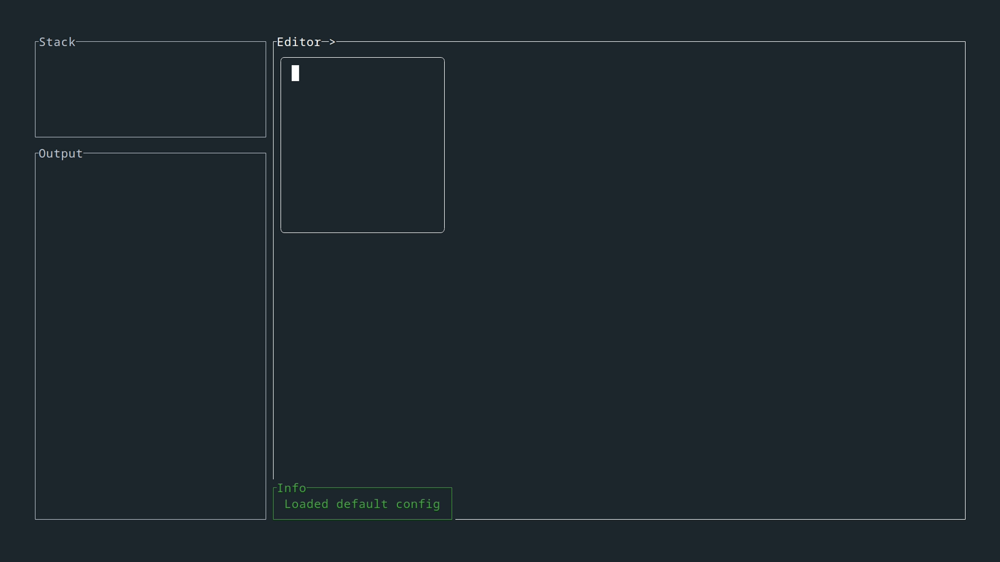
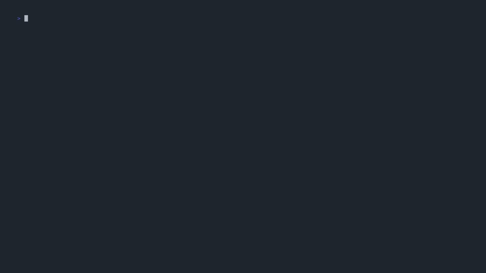

<p align="center">
  
  <br><br>
  A TUI Befunge IDE.
</p>

<p align="center">
  
</p>

# Config

An example default config is available in the `assets/config` folder.

The `PUCCINIA_CONFIG_PATH` environment variable must be defined and point to your config folder.

# Examples

The `befunge` folder contains a couple examples of Befunge programs.

# Usage

## Befunge

If you're new to Befunge, the [Esolang wiki](https://esolangs.org/wiki/Befunge) is a great source of information and simple examples.

## Puccinia

Run `puccinia myfile.befunge` (will create a new file if it does not exist).

Much like in Vim, you can use commands by inputting a colon (`:`). Try using `:help` for a list of built-in commands.

Settings and keybinds can be edited in your `config.pucci`.

## Custom [Rune](https://github.com/rune-rs/rune) commands

### Creating a command

Commands can be defined by adding them to the `config/commands` folder and "linking" them in the `config.pucci` (see example at the end of the provided default config).
Commands must always take a `State` as first parameter and a vector of all the arguments passed by the user as a second parameter. Type-checking is done on function call based on the function documentation in the `config.pucci` so you don't have to worry about it. The identifier on the right side of the `=` sign should be the name of the Rune **function** (not file).

Here's a short gif demonstrating how to create and link a new command:

<p align="center">
  
</p>

### Rune API

```rust
struct State {
    mode: EditorMode,
    grid: Grid,
    tooltip: Option<Tooltip>,
    config: Config,
    history: History,
}

/// Push the current state of the grid as a history slice (does nothing if nothing has changed since the last slice)
State::push_history(self);
/// Load the desired history slice
State::load_history(self, index: u32);
```

```rust
enum EditorMode {
    Normal,
    Command(String),
    Visual((u32, u32), (u32, u32)),
    Insert,
    Running,
    Input(InputMode, String),
    History(u32),
}

enum InputMode {
    Integer,
    ASCII,
}
```

```rust
struct Grid {
    width: const u32,
    height: const u32,
    cursor: (u32, u32),
    cursor_direction: Direction,
    // Direct access coming at a later date
    // inner: VecDeque<VecDeque<Cell>>,
}

// Init grid from a befunge program in string form
Grid::from(value: String) -> Self;

```

```rust
enum Cell {
}

enum Direction {
    Up,
    Down,
    Left,
    Right,
    Random,
}
```

## Features

- [x] 2D grid-based editor
- [x] Syntax highlighting
- [x] Vim-inspired modal control scheme
- [x] Edit history
- [x] Live run mode with breakpoints
- [x] Commands and configurable settings
- [x] Config file
  - [x] Custom keybindings
  - [x] Default config example
  - [x] Autosave
- [x] Custom commands (scripting language + API)

## Roadmap

In order of how willing I am to do them right now:

- [ ] Documentation and examples
- [ ] Funge-98 extensions (excluding fingerprints)
  - [ ] Stack stack
  - [ ] Concurrency
  - [ ] Simple new instructions
  - [ ] Annoying new instructions
  - [ ] Trefunge
- [ ] Funge-98 fingerprints
